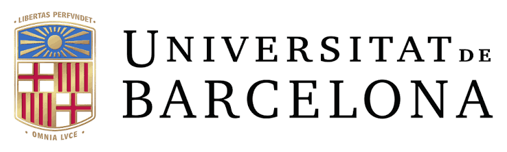

The **Barcelona Babylab Network (BCN-BN)** is a collaborative research community based in Barcelona, dedicated to advancing our understanding of infant development and cognition. We bring together researchers, clinicians, and institutions to conduct rigorous, innovative research on how babies learn and develop.

The BCN-BN is an initiative led by postdoctoral researchers **Konstantina Zacharaki** [](https://www.linkedin.com/in/konstantina-zacharaki-1a6460138/) (*Universitat de Barcelona*) and **Gonzalo García-Castro** [](https://www.linkedin.com/in/gongcastro/) [](https://github.com/gongcastro) (*Institut de Recerca Sant Joan de Déu, IRSJD*), with the support of their respective research groups, [Brain Mechanisms of Language Learning](https://www.ub.edu/brainvitge/groups/language-learning/) (PI Ruth de Diego Balaguer ) and [Neurodevelopment and Comparative Cognition](https://www.irsjd.org/es/investigacion/76/neurodevelopment-and-comparative-cognition-neurodevco) (PI Chiara Santolin).

{ height="80px" fig-align="left"}
{ height="50px" fig-align="right"}

---

### Interested in Joining?

If you're a researcher interested in infant development and would like to connect with our network, please get in touch at [**gonzalo.garcia@sjd.es**](mailto:gonzalo.garcia@sjd.es) or [**k.zacharaki@ub.edu**](k.zacharaki@ub.edu).
